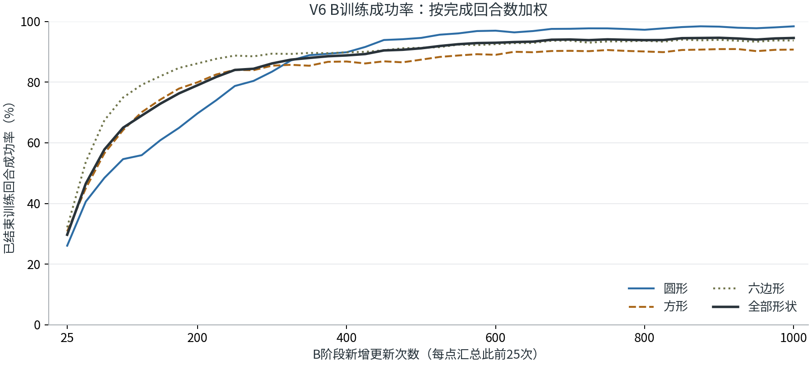

# ContactForge

**接触反馈机器人装配 · Contact-aware robotic assembly**

[](https://github.com/ZaowenChen/contactforge/actions/workflows/checks.yml)
[](LICENSE)

ContactForge 研究机器人如何利用本体感觉和接触反馈，在位置与姿态存在偏差时完成寻孔、对齐和插入。当前发布聚焦 **V6：圆形、方形、六边形共享策略的笛卡尔插入**，基于 MuJoCo / MJLab、六维力／力矩（F/T）与带辅助监督的 PPO。

**已完成的 B1000 评估：0.05 mm 单边间隙，5802 / 6144 成功，成功率 94.43%。** 成功指首次合法到位；本轮没有到位后的持续保持，也没有实机验证。

[方法与运行说明](docs/V6.md) · [结果与限制](docs/RESULTS.md) · [发布范围与来源](docs/RELEASE.md)

## 当前成果

| 形状 | 成功 / 总数 | 成功率 |
|---|---:|---:|
| 圆形 | 2022 / 2048 | 98.73% |
| 方形 | 1866 / 2048 | 91.11% |
| 六边形 | 1914 / 2048 | 93.46% |
| **合计** | **5802 / 6144** | **94.43%** |

实际实验从 **A100**（0.5 mm 单边间隙的第 100 次更新检查点）初始化，换用新优化器，在 **B**（0.05 mm）新增训练 1000 次。它与从零运行 A1000 → B1000 的完整课程不同。

判据是在 8 s 回合内，以 1 ms 采样首次满足 **40 ± 1 mm 座深、整轴几何合法，以及全回合未触发 50 N / 2 N·m 过载**。主轴身容差为 25 μm；同批终态按 5 μm 容差复核为 5698 / 6144（92.74%）。同拍过载优先于成功，没有成功速度门槛。



图中每点按此前 25 次更新的已结束回合数加权，属于训练统计。上表来自最终模型的独立评估起点，不能与训练曲线混用。原始结果摘要和权重哈希见 [reference/v6_b1000.json](reference/v6_b1000.json)。

## 方法

- **历史观测**：每帧 30 维本体信息 + 6 维补偿后的 F/T，维护 30 帧历史；策略以 50 Hz 更新。
- **共享时序表征**：本体与 F/T 分别投影后相加，最近 29 帧进入 TCN。32 维历史特征与最新 36 维观测拼接，送入 Actor。
- **辅助监督**：Contact Head 和 Pose Head 在训练期使用仿真标签塑造共享表征；Actor 动作计算不读取这些预测或真值。Critic 使用特权状态。
- **顺应执行**：6 维动作更新轴尖笛卡尔参考；1 kHz 底层控制结合 F/T 调节参考、卸载，并由环境记录过载终止。
- **机械模型**：轴固定在带 XYZ 被动平移弹簧的载体上，单策略覆盖三种截面。

F/T 使用策略间隔内的均值，控制器也有滤波；这里不声称零延迟响应。辅助头仍保存在训练检查点中，仓库没有单独导出到实机的部署包。

## 快速开始

需要 Linux、Python 3.10+ 和兼容的 NVIDIA CUDA 环境进行训练。代码依赖特定版本的接触兼容补丁，已核验版本见 [运行环境](docs/V6.md#运行环境)。先安装适合本机 CUDA 的 PyTorch，再在克隆目录中安装项目：

```bash
git clone https://github.com/ZaowenChen/contactforge.git
cd contactforge
python3 -m venv .venv
source .venv/bin/activate
# 安装与本机匹配的 PyTorch 后：
python -m pip install -e .

# 查看入口；不会启动训练
bash scripts/run_local.sh python scripts/blind_study_job.py --help

# 保留的 V6 回归检查：CPU 执行，无训练
bash scripts/run_local.sh python -m unittest discover -s tests -v
```

仅支持从源码克隆目录使用（含 `assets/`），使用 editable install；当前不提供独立 wheel 资产分发。已有兼容虚拟环境时，可以设置 `CONTACTFORGE_RUNTIME=/path/to/venv` 复用它。

### 单阶段训练

每次使用新的输出目录。下面是正式配置，默认 **12288 环境 × 32 步 × 1000 更新**，需要足够 GPU 内存；每 50 更新保存权重，仅在最终更新后评估。

```bash
# A：0.5 mm 单边间隙，从零训练
bash scripts/run_local.sh python scripts/blind_study_job.py \
  evaluation/my_A --config configs/blind_v6_cartesian_ft_A_05mm.json

# B：0.05 mm 单边间隙，从已有 A 权重初始化，新优化器训练
bash scripts/run_local.sh python scripts/blind_study_job.py \
  evaluation/my_B --config configs/blind_v6_cartesian_ft_B_005mm.json \
  --initialize-from /absolute/path/to/A/checkpoint_00100.pt
```

启动器在后台运行，保存 `job.json`、冻结源码、日志与 `status.json`。更改环境数、短链路预算、完整 A→B 课程、独立评估及 TensorBoard 用法见 [V6 运行说明](docs/V6.md)。

上面的 B 命令可接续本发布配置新训练的 A。使用原 2026-10-22 的 A100 时，还需保留其评估计划元数据，具体命令见 [原 A100 兼容说明](docs/V6.md#使用原实验的-a100)。

**训练权重、原始日志和轨迹不随 Git 分发。** 新克隆可以创建新实验；重放已报告结果需要另外取得原 A100/B1000 权重与对应产物。

## 仓库布局

```text
configs/                  V6 A / B 两份有效配置
src/mjlab_contact_prep/    V6 训练、评估、控制与必要公共依赖
scripts/                  训练 CLI、单阶段任务、A→B 课程与运行器
assets/                   机械臂、夹爪与轴的必要模型；孔由代码生成
tests/                    V6 几何、控制、观测隔离和 F/T 回归检查
docs/                     方法、结果、发布范围和一张训练曲线
reference/                结果摘要、源码来源与校验清单
```

Python 导入名 `mjlab_contact_prep` 和现有训练脚本名保留，以兼容已保存的 V6 检查点与来源记录。发布副本已移除旧 SPIKE 入口、历史配置、一次性诊断脚本、无关测试和旧孔网格。仍被 V6 继承或校验的公共模块保留。

## 后续探索

| 方向 | 研究问题 | 本次发布范围 |
|---|---|---|
| 原夹爪与自由工件 | 夹持滑移、接触与装配力耦合 | 独立研究分支，未纳入 V6 发布 |
| SO-101 本体感觉装配 | 无六维力传感时的接触可观测性 | 独立研究分支，未纳入 V6 发布 |
| USB / RJ45 连接器 | 复杂截面、弹性卡扣与到位判据 | 资产探索，未纳入 V6 发布 |

这些路线不继承 V6 的 94.43% 成绩。路线说明参考 2026-10-26 项目总览，后续研究分支的进展需单独核对。

## 来源与许可

本仓库从 [MJLab Peg-Hole Search](https://github.com/ZaowenChen/mjlab-peg-hole-search) 的已验证 V6 版本整理而来；原仓库继续保存历史开发记录。网络参考了 Blind Precise Assembly 的历史编码与辅助监督思路，本地增加 F/T、笛卡尔控制和独立成功协议，来源记录见 [发布说明](docs/RELEASE.md#方法来源)。

原创代码与文档使用 [MIT](LICENSE)。MuJoCo Warp 兼容代码保留 Apache-2.0，模型资产权属另见 [第三方说明](ASSETS_AND_THIRD_PARTY.md)。
